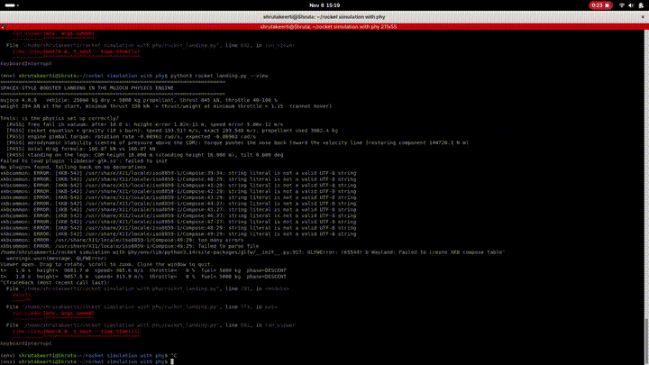
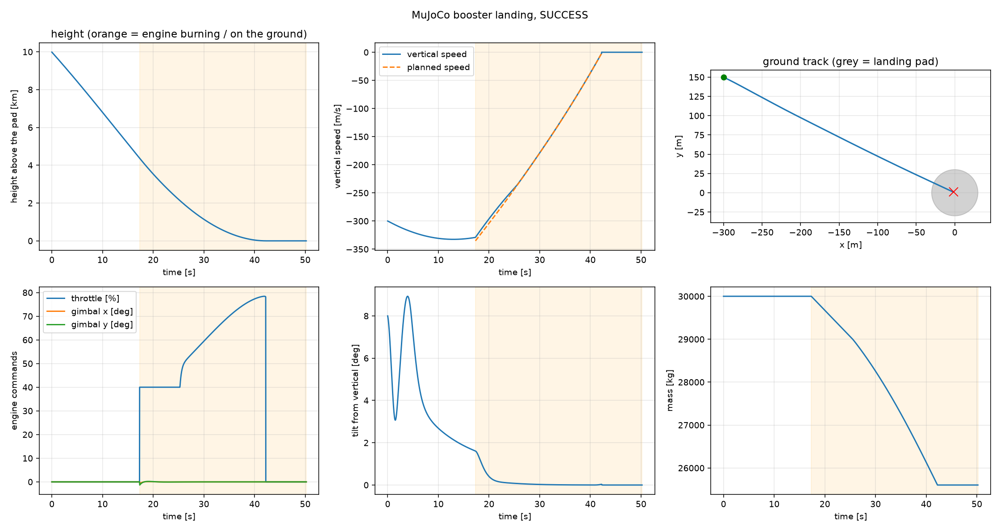

# 🪔 Diwali Rocket: landing a rocket from first principles

> Every Diwali we light rockets and watch them climb, burn out and fall. This project asks the engineer's version of that question: **what does it take to bring a rocket back down and set it on its legs?**

Built around Diwali 2026, in two parts:

1. **A from-scratch 2D flight simulator**, built in verified steps: numerical integration → ascent physics → gravity turn → aiming → Monte Carlo errors → feedback guidance → Kalman filter.
2. **A 3D rigid-body booster landing in the [MuJoCo](https://mujoco.org) physics engine**: engine gimbal, throttle limits (it cannot hover), reaction control, grid fins, drag, landing legs with real ground contact, and an autopilot that times a SpaceX-style "suicide burn".

Every piece is tested against an exact answer before anything is built on it, and every result below states its limits.





## Highlights

- **MuJoCo landing:** soft upright touchdown (0.53 m/s vertical, 0.19 m/s sideways, 0.03° tilt, 2 m from the pad centre) in the nominal case; **159 of 160** randomised landings succeed across three seeds; it degrades gracefully when the errors are doubled (88%) and tripled (42%).
- **Minimum throttle above hover thrust**, as on a real booster: the burn has to be timed, not hovered.
- **Verification first:** physics tests against exact answers (free fall, the rocket equation, gimbal torque, drag, stability, standing on the legs). The tests caught several real bugs (see below).
- **Kalman filter with a consistency test** (NEES 6.43 against an ideal of 6), compared against two raw-sensor alternatives.

## Repository layout

```
.
├── README.md
├── requirements.txt
├── mujoco_landing/
│   └── rocket_landing.py        # the 3D MuJoCo booster landing (standalone, one file)
├── sim2d/                       # the 2D simulator, one file per step (run from this folder)
│   ├── rk4_check.py
│   ├── phase1_ascent.py
│   ├── phase2_gravity_turn.py
│   ├── kick_experiment.py
│   ├── speed_check.py
│   ├── phase3_shooting.py
│   ├── phase4_montecarlo.py
│   ├── phase5_feedback.py
│   └── phase6_kalman.py
└── docs/                        # plots
```

## Quick start

```bash
python -m venv env && source env/bin/activate
pip install -r requirements.txt

# Part 2: the 3D landing
python3 mujoco_landing/rocket_landing.py --view        # interactive MuJoCo window
python3 mujoco_landing/rocket_landing.py               # tests + one landing + telemetry plots
python3 mujoco_landing/rocket_landing.py --mc 50       # 50 randomised landings
python3 mujoco_landing/rocket_landing.py --mc 50 --stress 2   # errors twice as large: where does it break?

# Part 1: the 2D simulator (the files import each other, so run from this folder)
cd sim2d
python3 phase6_kalman.py
```

Video output (optional): `pip install imageio imageio-ffmpeg`, then `--video landing.mp4`.

## Part 2: the 3D booster landing (MuJoCo)

**What is simulated**

| Element | Model |
|---|---|
| Vehicle | 42 m booster, 25 t dry + 5 t landing propellant, 6 degrees of freedom, inertia that changes as it burns |
| Engine | One engine, 845 kN, gimbal ±5°, throttle 40 to 100 % (thrust/weight is 1.15 at minimum, so it cannot hover), Isp 282 s |
| Attitude control | Engine gimbal plus cold-gas RCS torque, with a control allocation between them |
| Aerodynamics | Axial and crossflow drag at a centre of pressure above the centre of mass, so engines-first flight is stable |
| Steering | Grid fins modelled as a force limited by dynamic pressure |
| Ground | Four landing legs with friction and real contact (tipping is possible) |
| Environment | Exponential atmosphere, altitude-dependent wind, and random errors in thrust, propellant, drag, air density and initial state |

**Autopilot.** Engines-first descent with grid-fin steering → ignite when the stopping distance at 70 % of the available deceleration equals the height → track a constant-deceleration speed profile with throttle → steer laterally with grid fins while the air is thick and engine tilt below that → cut at touchdown.

**Results** (the autopilot sees the true state; the vehicle numbers are plausible but made up)

| Test | Result |
|---|---|
| Nominal landing | 0.53 m/s vertical, 0.19 m/s sideways, 0.03° tilt, 2.0 m from the pad centre, upright after 8 s |
| 40 random landings (seed 1, used for tuning) | 39 succeed |
| 60 random landings (seed 2, unseen) | 60 succeed |
| 60 random landings (seed 3, unseen) | 60 succeed |
| Errors ×2 (40 landings) | 35 succeed (88 %) |
| Errors ×3 (40 landings) | 17 succeed (42 %); the worst impacts are all propellant exhaustion |

A landing counts as a success only if all of these hold: vertical speed ≤ 3 m/s, sideways speed ≤ 2 m/s, tilt ≤ 8°, rotation rate ≤ 0.3 rad/s, within the 30 m pad radius, no hull contact, and still upright 8 s later.

## Part 1: the 2D simulator, step by step

| Step | File | What it teaches | Key result |
|---|---|---|---|
| 1 | `rk4_check.py` | Prove the integrator on a known answer | RK4 order → 3.99; Euler gains ~150× energy in 100 s |
| 2 | `phase1_ascent.py` | Variable-mass vertical ascent, drag, gravity | 3306 m/s ideal → 1810 m/s at burnout (gravity loss 1366, drag loss 130) |
| 3 | `phase2_gravity_turn.py` | One small kick, then gravity bends the path | 146 km apex, 519 km downrange; huge sensitivity to the kick |
| 4 | `phase3_shooting.py` | Find the kick that hits a target (bisection) | Two solutions at 400 km (0.399° and 1.195°); maximum range 522.7 km |
| 5 | `phase4_montecarlo.py` | Random errors and an error budget | Landing scatter 16.8 km (steep arc) vs 80.7 km (flat arc); the budget predicted 17.1 and 77.6 |
| 6 | `phase5_feedback.py` | Cut the engine when the predicted landing equals the target | Scatter 13.3 → 0.16 km (steep), 47.4 → 10.6 km (flat) |
| 7 | `phase6_kalman.py` | IMU + GPS fused by an extended Kalman filter | Total miss 0.12 km with the filter vs 17.4 km (GPS-hold) and 3.7 km (IMU-only) |

Also in `sim2d/`: `kick_experiment.py` and `speed_check.py` print the kick-angle comparison and the speed over time as text.

Run times on a single core: step 5 about 1 minute, step 6 about 2, step 7 about 3.

## What the tests caught

Tests that can fail are the point of the project. Real problems they found:

- **Phase 5:** with no errors at all, the cutoff controller overshot by 1.5 km. The predicted range accelerates as the rocket gets lighter, so a linear extrapolation cut late. Fixed with a faster terminal guidance cycle.
- **Phase 5:** the controller's own tests fail below 350 km on the steep arc (more thrust makes it land shorter), so the supported range is documented.
- **Phase 4:** a free gravity turn cannot start from rest (the `g/v` term amplifies any disturbance by about 10¹¹); the rocket has to be held vertical first.
- **Phase 6:** scatter alone made a biased method look good. The summary now reports the total miss (RMS).
- **MuJoCo:** a changed body mass is ignored until `mj_setConst` runs. The rocket-equation test exposed a 0.5 s mass lag.
- **MuJoCo:** my first landing speed profile demanded ever-increasing deceleration near the ground; it is now a constant-deceleration profile.

## Limitations

- The MuJoCo autopilot sees the **true state**. The Kalman filter from the 2D simulator is not plugged into it yet.
- The flight starts at 10 km already engines-first. The flip, boostback burn and hypersonic re-entry are not simulated.
- Grid fins are an ideal force without torque; the vehicle and error numbers are plausible but are not Falcon 9 data.
- The 2D simulator only measures downrange error. Nothing here has been validated against real flight data.
- The autopilot was tuned on one set of random draws; the two unseen sets are the fairer estimate.

## Roadmap

- [x] Verified 2D simulator with Monte Carlo, feedback guidance and a Kalman filter
- [x] MuJoCo booster landing with tests, Monte Carlo and a stress test
- [ ] Plug the Kalman filter into the MuJoCo autopilot (land from noisy sensors)
- [ ] Flip and boostback burn; start the landing from the apex
- [ ] Learned estimator and controller compared against these baselines (including a reinforcement-learning policy as a Gymnasium environment)
- [ ] Compare against published reference cases and real data where available

## References

- MuJoCo physics engine (Google DeepMind): <https://mujoco.org>
- Zipfel, *Modeling and Simulation of Aerospace Vehicle Dynamics*
- Simon, *Optimal State Estimation*
- Curtis, *Orbital Mechanics for Engineering Students*


---

*Shubh Deepavali. May your rockets go up, and your landings be soft.* 🪔
